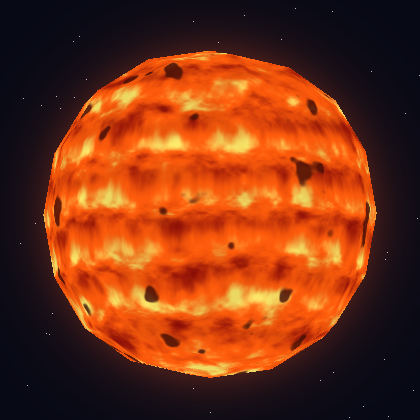
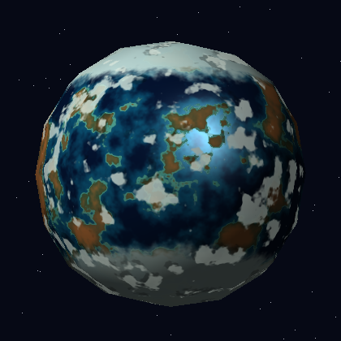
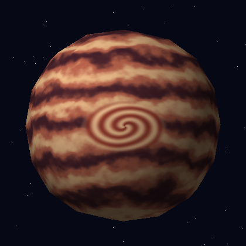

# Atlas de mundos — laboratorio de shaders procedurales en CPU

Una **sola esfera OBJ** da forma a Helia, Nácar y Véspera. Un rasterizador de triángulos en JavaScript recorre los fragmentos en CPU, calcula su posición y normal interpoladas, y llama a uno de tres shaders. No se usan WebGL, imágenes de textura, materiales externos ni geometría adicional. `assets/sphere.obj` es una copia intacta de la esfera proporcionada (98 vértices, 192 caras triangulares). `src/sphere-data.js` contiene el mismo texto para que `index.html` funcione incluso al abrirlo con `file://`.

## Ejecutar

1. Abre **`index.html`** en un navegador moderno. No hay que compilar ni instalar paquetes. La fuente visual usa fuentes del sistema y el proyecto funciona sin internet.
2. Elige un cuerpo con los botones o las teclas **1, 2 y 3**. Arrastra la esfera para girarla. Usa **Espacio** para pausar y el control de tiempo para estudiar un instante concreto.
3. Activa **Patrón en grises** para ver la señal que decide las regiones de color. En Nácar puedes activar y desactivar nubes y sombras por separado. El botón **↓** guarda el fotograma actual en PNG.

La primera imagen puede tardar un instante porque todos los píxeles se calculan en CPU. El indicador superior muestra el tiempo de renderizado.

## Cuerpos celestes

### 1. Helia — estrella activa



[Patrón en escala de grises](docs/screenshots/helia-patron.png) · [GIF del flujo y pulso](docs/animation/helia.gif)

`src/star.js:star` mezcla ruido fractal de alta frecuencia con una onda horizontal distorsionada por ruido de baja frecuencia. La señal **heat** alimenta una paleta de tres temperaturas; otra máscara de ruido define manchas oscuras. El tiempo desplaza el flujo y modula ligeramente el brillo. Helia emite su propio color, así que no utiliza la luz externa. Para experimentar, cambia `PARAMS.granulation` (tamaño de los gránulos), `turbulence` (deformación), `spotThreshold` (cantidad de manchas) o `pulseSpeed` (velocidad del pulso).

### 2. Nácar — planeta rocoso y oceánico



[Patrón en escala de grises](docs/screenshots/nacar-patron.png) · [GIF de nubes móviles](docs/animation/nubes.gif) · [GIF de iluminación y reflejo al girar](docs/animation/luz-y-reflejo.gif)

`src/rocky.js:rocky` utiliza ruido fractal para decidir la altitud. Un umbral suave `seaLevel` separa océano y tierra; un intervalo estrecho crea la costa. Ruido fino rompe los bordes y añade variedad a la tierra. La latitud genera casquetes polares. `cloudField` gira sus coordenadas con `cloudSpeed`, por lo que la capa atmosférica se mueve sobre un terreno fijo. Una segunda muestra desplazada de esa máscara oscurece la superficie como sombra. La iluminación difusa afecta al terreno y al mar; el océano recibe un brillo especular localizado. Cambia `PARAMS.continentScale`, `seaLevel`, `cloudThreshold`, `cloudSpeed` o `iceLatitude` para observar el resultado.

### 3. Véspera — gigante gaseoso



[Patrón en escala de grises](docs/screenshots/vespera-patron.png) · [GIF de corrientes lentas](docs/animation/vespera.gif)

`src/gas.js:gas` genera bandas con una onda de latitud. Dos frecuencias de ruido y una ondulación de longitud **desplazan la coordenada antes de evaluar la onda**, de modo que los límites fluyen en vez de ser franjas rectas. Una máscara elíptica de longitud y latitud coloca una gran tormenta con líneas espirales internas. El resultado recibe luz difusa y una pequeña componente ambiental. Cambia `PARAMS.bandFrequency` (número de franjas), `warpStrength` (curvatura), `stormLongitude`, `stormLatitude` o `stormSize`.

## Efectos solicitados para evaluación

Cada fila señala un comportamiento observable una sola vez. La consigna facilitada indica 150 puntos disponibles, pero no incluye el desglose numérico por efecto; por ello no se asignan puntos inventados aquí.

| Efecto | Cuerpo | Archivo y función | Evidencia | Parámetro y cambio visible |
|---|---|---|---|---|
| Superficie solar turbulenta y manchas | Helia | `src/star.js:star` | [Imagen](docs/screenshots/helia.png) | `spotThreshold`: reduce o amplía las zonas oscuras. |
| Material animado independiente de las nubes | Helia | `src/star.js:star` | [GIF](docs/animation/helia.gif) | `pulseSpeed`: acelera el pulso luminoso. |
| Regiones de océano, continentes y costa | Nácar | `src/rocky.js:rocky` | [Imagen](docs/screenshots/nacar.png) | `seaLevel`: cambia la proporción de mar y tierra. |
| Hielo polar | Nácar | `src/rocky.js:rocky` | [Imagen](docs/screenshots/nacar.png) | `iceLatitude`: mueve el inicio del hielo. |
| Nubes con movimiento propio | Nácar | `src/rocky.js:cloudField`, `rocky` | [GIF](docs/animation/nubes.gif) | `cloudSpeed`: modifica su velocidad respecto al terreno. |
| Sombras de nubes | Nácar | `src/rocky.js:rocky` | [GIF](docs/animation/nubes.gif) | Desplazamiento `displaced`: cambia la separación nube/sombra. |
| Reflejo del océano y luz difusa | Nácar | `src/rocky.js:rocky`, `src/shader-common.js:lit` | [GIF al girar](docs/animation/luz-y-reflejo.gif) | Exponente `35`: estrecha o extiende el brillo. |
| Bandas líquidas deformadas | Véspera | `src/gas.js:gas` | [Imagen](docs/screenshots/vespera.png) | `warpStrength`: modifica cuánto serpentean las bandas. |
| Tormenta elíptica espiral | Véspera | `src/gas.js:gas` | [Imagen](docs/screenshots/vespera.png) | `stormSize`: cambia el diámetro de la tormenta. |

## Cómo funciona

`src/obj.js:parseOBJ` lee las posiciones y caras de la esfera, la centra y escala sin modificar el archivo ni su topología. `src/renderer.js:render` proyecta sus 192 triángulos, calcula coordenadas baricéntricas y usa un **z-buffer** para conservar el fragmento visible. La posición interpolada se normaliza y se pasa al shader junto con la normal rotada, el tiempo y las opciones de diagnóstico. Los tres shaders usan la **misma instancia de malla**. `src/noise.js` contiene ruido de valor tridimensional determinista y `fbm` combina octavas. El halo de Helia y el fondo son efectos de pantalla; no añaden modelos a la escena.

## Exportar y probar

Con **Node.js 18 o superior**, sin `npm install`:

```bash
npm test
node tools/render.js star mi-estrella.png 420 0
node tools/render.js rocky mi-planeta.gif 240 0
node tools/render.js gas mi-patron.png 280 0 grayscale
node tools/render.js rocky giro.gif 240 0 turn
```

La sintaxis es `node tools/render.js <star|rocky|gas> <salida.png|salida.gif> [tamaño] [tiempo] [normal|turn|grayscale]`. `turn` gira la vista en 12 fotogramas; `grayscale` muestra el patrón base. `npm test` comprueba la malla, la diferencia entre shaders, los diagnósticos, la animación y las firmas de PNG/GIF.

## Estructura

- `assets/sphere.obj`: geometría original de la práctica.
- `src/renderer.js`: rasterizador CPU y selección del fragment shader.
- `src/star.js`, `src/rocky.js`, `src/gas.js`: apariencias procedurales.
- `src/app.js`, `index.html`, `style.css`: visor y controles.
- `tools/`: exportadores PNG/GIF sin dependencias.
- `docs/`: capturas y GIF verificables.

No hay repositorio remoto configurado en esta entrega local. Para entregar el enlace de GitHub, crea un repositorio en tu cuenta, añade su URL como `origin` y sube la rama con `git push -u origin master`.
